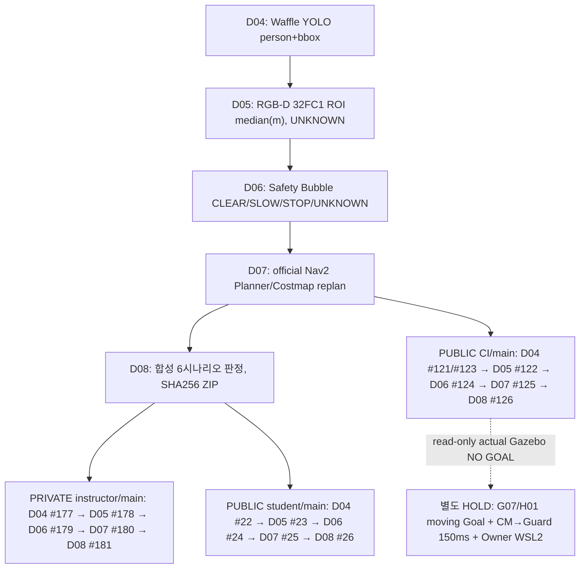

# AXIA Block B D04~D08 브랜치 구조 및 병합 완료 브랜치 정리 (2026-11-15)

## 0. 인수 경계

본 문서는 **원격 GitHub ref 목록·PR merge 기록·공개 Actions 실제 DELETE 로그**를 기준으로 작성했다. 기존 세 저장소의 `main` 코드는 변경하지 않는다. **보호 중인 G07/H01 실제 이동·Guard 150ms·Contact-free·Owner WSL2 L3는 HOLD**이다. SW Stop은 인증 하드웨어 E-Stop이 아니다.

| 저장소 | 최종 교육 main SHA | D04~D08 삭제 확인 | 아직 남는 브랜치 |
|---|---|---:|---|
| Instructor (private) | `94e6b8572146f0c6ec61a15e5ac1b6734cfd5fa2` | **0** — GitHub 직접 DELETE 도구 없음, PRIVATE Actions 금지 | **32 현재**, Owner WSL2 원샷 성공 시 **12 예상** |
| Student (public) | `b298df52581e0ba4ee82227d72d602f2c491d792` | **20/20 + 임시 ops branch 1 삭제** | **0** (D04~D08 scope) |
| CI (public) | `0f66059d9110f8e667200bbca22396bd0c78c02e` | **24** | 검증 미완료/독립 진단 **12** + 임시 ops **1** |

- Student: [strict main ancestry 11](https://github.com/silverbjin/axia-robot-safety-student/actions/runs/43680550823), [closed PR→successor main 9](https://github.com/silverbjin/axia-robot-safety-student/actions/runs/43680953670), [ops cleanup self-removal](https://github.com/silverbjin/axia-robot-safety-student/actions/runs/43681699405).
- Public CI: [strict first 16](https://github.com/silverbjin/axia-robot-safety-ci-public/actions/runs/43680464836), [second 6](https://github.com/silverbjin/axia-robot-safety-ci-public/actions/runs/43680886361), [closed PR→merged successor 2](https://github.com/silverbjin/axia-robot-safety-ci-public/actions/runs/43681149965).
- Private Owner **ONE-SHOT (아직 현장 미실행)**: `scripts/axia_d04_d08_instructor_branch_cleanup_once.sh` at immutable public SHA `7c8fdfc9f31ee80e45b97f8cb0cadc365495bbb2`; 원본 SHA·현재 PR의 head/base·병합 후속 commit을 재확인해 **main ancestor 11 + superseded 8 + 다른 활성 브랜치 조상 1 = 최대 20** 삭제. 비공개 GitHub Actions 미사용.
- 공개 CI의 `release/d06-g07-observer-owner-20261115`는 `release/d06-g07-owner-g11-pinned-20261115`보다 **2 커밋 앞으로 진척**돼 있어 **삭제하지 않았다**. [최초 실패](https://github.com/silverbjin/axia-robot-safety-ci-public/actions/runs/43681815806)는 **compare 방향 오판**으로, 테스트가 fail closed 한 것이다. 두 브랜치는 보존하여 G07 Owner source SHA 관계를 후속 안전 게이트에서 점검한다.

## 1. 세 저장소 main으로 통합된 개발 흐름

- 재사용된 실제 출력: D04 YOLO, D05 RGB-D(과거), D06 CM 격리 L1, D07 official Planner L1, D08 **actual Gazebo near/far NO-GOAL L2 + upstream C++ yolo_ros replay L1**. 이는 최종 G07 이동 인수가 아니다.
- **교육용 산출물**: 학생 TODO와 Instructor hidden tests/정답은 서로 다른 저장소로 유지한다.
- 커밋과 예전 PR은 보존된다. ref 삭제가 GitHub의 merged PR/commit/Actions 원본 증거를 지우지는 않는다.

## 2. 공개 CI에 남겨둔 D04~D08 브랜치 (12개)

| 브랜치 | 역할 | 왜 보존/목표 |
|---|---|---|
| `ci/d08-dns-parity-20261112` (#56) | Runner host↔Docker DNS 전제 진단 | 인프라 분리 조사 Draft, 아직 main 반영/종료 판정 미완료 |
| `ci/d08-ubuntu-mirror-20261112` (#57) | 서명 검증된 Noble APT 미러 fallback | 과거 DNS 복구 증거, 새 정기 배포 기준 채택 여부 별도 결정 |
| `feature/d05-sealed-l0-l1-20261109` | 구형 비공개 보호 환경 경로 | 현재 **사용 금지**, branch에 main 미포함 커밋 있으므로 무증거 삭제 금지; 이후 공개-only 대체 증거 확인 후 아카이브 |
| `feature/d06-gazebo-rviz-owner-20261114` (#108) | Gazebo+RViz 안전 Bubble read-only 시각 및 Owner 연계 | L1 관찰기는 main, 실시간 G07 병행·CM TTL은 HOLD |
| `release/d06-g07-observer-owner-20261115` | G07 Owner observer 추가 2커밋 | G11 pinned 대비 **최신 2커밋**, **통합되지 않음**. 후속 source 진단/인수 필요 |
| `release/d06-g07-owner-g11-pinned-20261115` | G11 source SHA 고정 릴리스 후보 | 먼저 확보한 G11 custody source anchor. 다른 branch보다 뒤이지만 참조 증거로 남김 |
| `feat/d07-h01-motion-lesson-20261114` (#115) | H01 사람 장애물 실제 Gazebo 우회·Controller 후보 | Gate1 NO-GOAL만 제한적 PASS, moving/contact-free/Owner L3 미인수 |
| `fix/d08-grounded-human-ci-20261111` (#50) | grounded human COLLADA·LiDAR 시각 보완 | 후속 기능 체인에서 아직 open PR head/base, 안전 범위 전체 미병합 |
| `release/d08-grounded-owner-wsl2-20261111` (#51) | private Owner source pin 배포 후보 | 실제 Owner GUI+Goal 인수 미완료, PR base 보존 |
| `fix/d08-foot-short-step-ci-20261111` (#52) | 근접 6cm foot/G07 정지 경계 오류 회귀 | 전체 Guard 실시간 TTL 미검증, 후속 #55 base로 사용 |
| `fix/d08-bgyntv7-actual-person-ci-20261112` (#55) | 실제 RGB ONNX class0 person, no-goal L2 | 부분 증거는 main #126, 아직 #58/#56/#57의 **활성 PR base** |
| `fix/d08-ui9-pre-goal-vision-ci-20261112` (#58) | 사람 near/far·C++ YOLO DetectionArray replay | NO-GOAL 코드 main 이식. Owner live D05·Goal·Guard TTL 등 잔여 증거 확보가 목표 |

임시 `ops/d04-d08-merged-branch-prune-20261115` **1개**는 현재 강사용 WSL2 Owner 원샷 공개 배포 소스다. private Owner 실행 후 완료 기록을 보존하고 별도로 삭제할 임시 작업 브랜치다.

## 3. Instructor 비공개 저장소 — 현존 32개 가운데 Owner 한 번 실행 후 보존할 것으로 예상되는 12개

| 보존 후보 | 역할 및 남는 이유 |
|---|---|
| `feat/d07-h01-real-avoidance-20261114` (#163) | D07-H01 실제 사람 회피 주행, Contact+Guard 경계 HOLD |
| `fix/d06-g07-bag-priority-20261114` (#172) | first CM source-gap/rosbag priority 원인 분석, open Draft |
| `fix/d06-g07-official-cm-core-affinity-20261115` | 실제 CM PID CPU-affinity/scan RMW 타이밍 최신 후보; **관찰 전용 observer-cpu 선행 브랜치 삭제 후 이 후보 유지** |
| `feature/d08-gazebo-live-one-world-20261110` (#91) | Waffle+human+RGB-D+YOLO P2 single-world, Owner 인수 전 |
| `fix/d08-g07-final-acceptance-20261110` | 초기 P2 G07 Goal/STOP 인수 후보, 다른 브랜치와 divergent (신규 미병합 커밋), 안전 원본 보존 |
| `integration/d08-g07-final-owner-20261110` (#95) | G07 정지/Contact/ordered shutdown 후보, 앞선 final-acceptance와 별도 히스토리 |
| `fix/d08-human-physical-model-20261110` (#96) | 한 사람 모델과 physical Contact 결합 |
| `fix/d08-humanoid-single-visual-rgbd-diagnostics-20261110` (#97) | 중복 시각/registered RGB-D 198ms 진단 |
| `fix/d08-g07-lidar-preflight-20261110` (#99) | 실제 GPU LaserScan/발높이 물리 사전 게이트, active PR 체인 |
| `fix/d08-grounded-human-visual-20261111` (#103) | COLLADA 발높이 수정, 후속 #105의 PR base |
| `fix/d08-foot-short-step-owner-20261111` (#105) | 실제 Owner short-step 감속/정지 증거 원본 판정 수정 |
| `fix/d08-ui9-reversible-pregoal-vision-20261112` (#113) | 근접 person→D05 pre-goal 관찰·원위치 복귀, 실시간 Owner L3 HOLD |

**Owner 원샷이 처리하도록 예정된 20개:** 11개 `main` 정확한 조상(앞선 D04–D08 병합 브랜치) + 8개 닫힌/후속 PR에 내용이 반영된 교육 브랜치 + 1개 CM core-affinity 후속 브랜치에 커밋이 포함된 observer CPU 중간 브랜치. **WSL2 실행 전에는 삭제 완료로 기록하지 않는다.**

## 4. 재개와 종단 인수 경계

- 교육 D04~D08 후속 개발은 각 저장소 `main`만 사용. student `main`에는 Python TODO, Instructor `main`에는 비공개 정답, public CI `main`에는 no-Goal 증거.
- D06/G07 노드 간 실제 CM **source/receive 150ms TTL**, 최초 `UPSTREAM_STALE_AFTER_MOTION`, D07 H01 동적 재계획에 따른 실제 이동, D08 Owner GUI person/D05와 STOP 후 odom 1초를 별도 P4 안전 회귀/인수로 진행.
- D04~D08 예전 SHA, PR, 공개 Actions는 삭제하지 않고 인계 문서에 출처를 남긴다.
- 더 이상 필요 없는 branch가 있어도 **열린 PR head/base, unique commits, 증거 source anchor**인 경우 자동 삭제하지 않는다.
